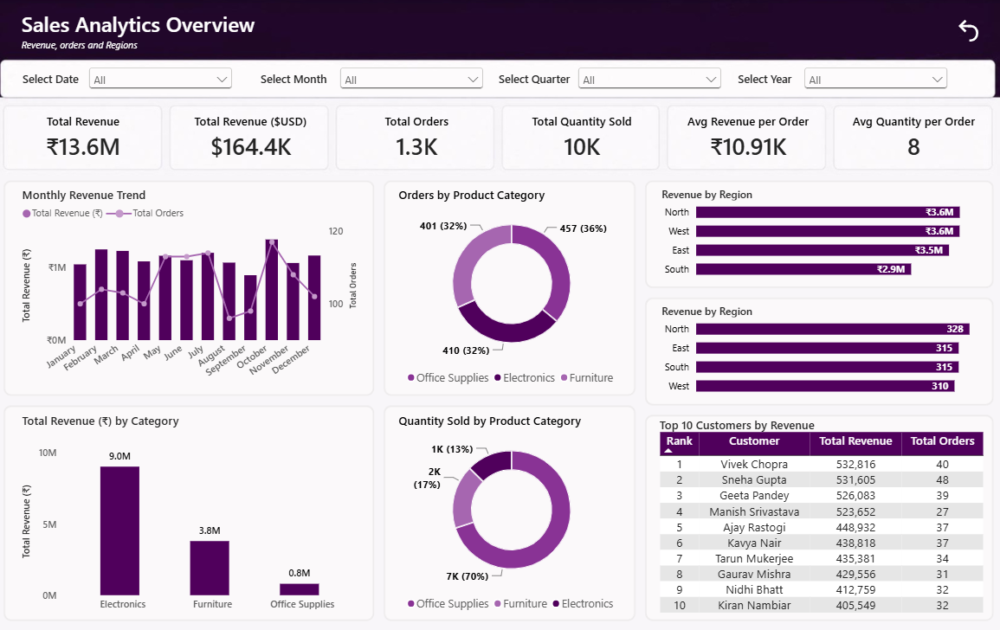
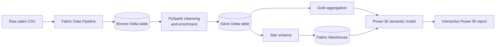
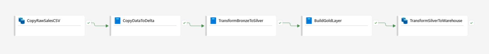
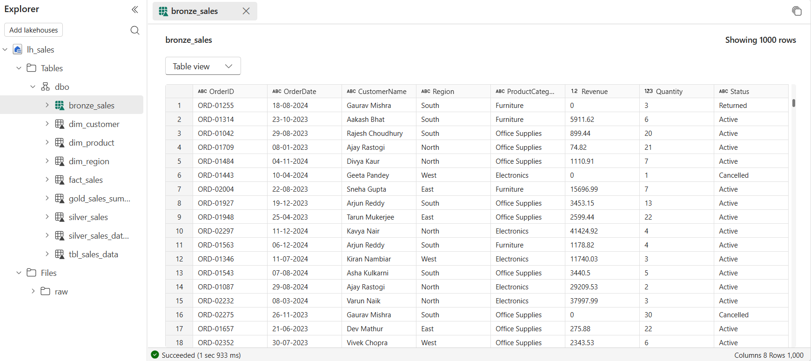
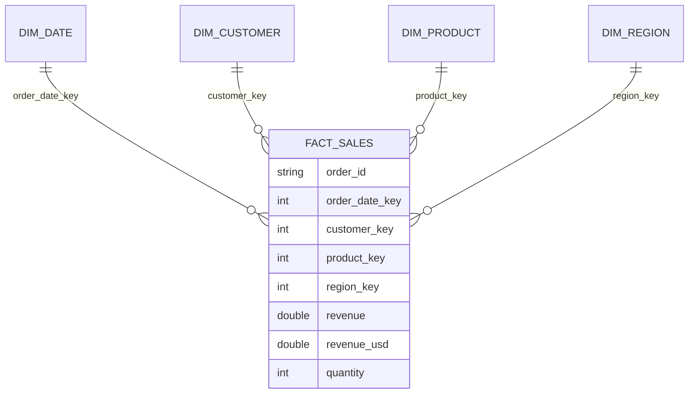
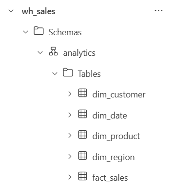

# Sales Analytics with Microsoft Fabric & Power BI


An end-to-end sales analytics project that turns raw transaction data into a decision-ready Power BI dashboard. The solution uses a Microsoft Fabric pipeline, a Bronze–Silver–Gold lakehouse design, PySpark transformations, a warehouse star schema, and a reusable semantic model with DAX measures.



## Project overview

The objective was to build a maintainable analytics workflow that answers five practical business questions:

- How are revenue and order volume changing over time?
- Which product categories generate the most revenue and unit sales?
- Which regions lead or lag in revenue and order activity?
- Who are the highest-value customers?
- How can users explore the results by date, month, quarter, and year?

The finished report combines executive KPIs with trend, product, region, and customer views on one interactive page. Cross-filtering and time slicers let users move from a high-level summary to individual business segments.

## Results at a glance

| Metric | Result |
|---|---:|
| Raw records ingested | 1,525 |
| Curated sales records | 1,268 |
| Distinct order IDs | 1,250 |
| Sales period | 2 Jan 2023 – 30 Dec 2024 |
| Total revenue | ₹13.64M |
| Converted revenue | $164.38K |
| Quantity sold | 10,043 |
| Customers / products / regions | 93 / 3 / 4 |

The cleaning rules removed 257 unusable records: 161 cancelled orders, 91 returned orders, and 5 active rows with zero revenue.

### Business insights

- **Electronics is the revenue engine:** it contributes ₹9.04M, approximately 66% of total revenue, from only about 13% of units sold.
- **Office Supplies drives volume:** it represents 7,028 units (70% of all units) and the largest number of sales records, but only ₹0.80M in revenue.
- **North and West are nearly tied:** each generates approximately ₹3.6M; South has the lowest revenue at ₹2.95M.
- **The product mix is value-led:** Electronics produces more than twice the revenue of Furniture despite similar order-record counts.

## Solution architecture



The orchestrated Fabric pipeline runs ingestion and transformation activities in sequence:



| Layer | Purpose | Main operations |
|---|---|---|
| Raw | Preserve the source extract | Copy the CSV into Fabric storage |
| Bronze | Create a queryable landing table | Infer the CSV schema and write `bronze_sales` in Delta format |
| Silver | Produce analysis-ready transactions | Keep active positive-revenue rows, standardize names and dates, and calculate USD revenue |
| Gold | Prepare business summaries | Aggregate revenue, order count, and average order value by month and region |
| Warehouse | Support reporting at scale | Publish a fact table and conformed customer, product, region, and date dimensions |
| Semantic model | Centralize business logic | Define relationships, measures, formatting, and report-ready fields |

## Data engineering

The notebooks use PySpark and Delta Lake to make each transformation stage explicit and repeatable:

1. [`CopyDataToDelta.ipynb`](fabric/notebooks/CopyDataToDelta.ipynb) loads the source CSV into `bronze_sales`.
2. [`TransformBronzeToSilver.ipynb`](fabric/notebooks/TransformBronzeToSilver.ipynb) filters invalid orders, converts the order date, applies snake_case naming, and adds `revenue_usd`.
3. [`BuildGoldLayer.ipynb`](fabric/notebooks/BuildGoldLayer.ipynb) creates the monthly regional `gold_sales_summary` table.
4. [`TransformSilverToWarehouse.ipynb`](fabric/notebooks/TransformSilverToWarehouse.ipynb) generates surrogate keys and builds the reporting fact and dimension tables.

The Lakehouse retains the intermediate Delta tables so the pipeline can be inspected and validated at every layer.



## Dimensional model

The reporting layer follows a star schema. `fact_sales` stores the numeric sales events and joins many-to-one to four dimensions.





The Power BI semantic model uses DirectQuery and contains measures for total revenue, USD revenue, orders, quantity, customer count, averages, and customer ranking. Example measures include:

```DAX
Total Revenue = SUM(fact_sales[revenue])

Avg Revenue per Order =
    DIVIDE(
        SUM(fact_sales[revenue]),
        DISTINCTCOUNT(fact_sales[order_id])
    )

Customer Rank =
    RANKX(
        ALL(dim_customer[customer_name]),
        [Total Revenue],
        ,
        DESC,
        Dense
    )
```

## Dashboard design

The single-page **Sales Analytics Overview** report includes:

- KPI cards for INR revenue, USD revenue, sales records, quantity, and per-order averages
- a monthly revenue and order trend
- revenue and quantity breakdowns by product category
- regional revenue and order comparisons
- a ranked top-10 customer table
- synchronized date, month, quarter, and year filters
- cross-filter interactions between the principal charts

The purple monochrome theme keeps category and regional comparisons consistent while reserving the strongest contrast for key values.

## Repository structure

```text
sales-report/
├── data/                         # Raw source and exported fact/dimension CSVs
├── fabric/
│   ├── notebooks/                # PySpark ingestion and transformation notebooks
│   └── semantic-model/           # TMDL model and Power BI report definitions
├── powerbi/                      # PBIX report and PBIP project pointer
├── screenshots/                  # Portfolio images used in this README
└── README.md
```

## Explore the project

### Review the report locally

1. Clone or download this repository.
2. Open [`powerbi/sales_report.pbix`](powerbi/sales_report.pbix) in Power BI Desktop.
3. If prompted, sign in to the Fabric/Power BI tenant that hosts the `sales_semantic` model or replace the data source with your own model.

The CSV exports in [`data/`](data/) make the curated dataset and model outputs reviewable without Fabric access.

### Reproduce the Fabric workflow

1. Create a Fabric workspace with a Lakehouse and Warehouse.
2. Upload `data/raw_sales_data.csv` to `Files/raw/sales_data.csv` in the Lakehouse.
3. Import the notebooks from [`fabric/notebooks/`](fabric/notebooks/) and attach them to the Lakehouse.
4. Run the notebooks in the same order shown in the pipeline screenshot.
5. Connect a semantic model to the warehouse tables and open the supplied report definition or rebuild the visuals in Power BI Desktop.

> [!NOTE]
> The portfolio dataset uses a fixed illustrative conversion of **₹83 = $1** and overwrite-mode notebook writes. A production version should use a dated FX-rate table, incremental loading, data-quality tests, and deployment pipelines.

## Skills demonstrated

`Microsoft Fabric` · `Data Pipelines` · `Lakehouse` · `Warehouse` · `PySpark` · `Delta Lake` · `Data Cleaning` · `Medallion Architecture` · `Dimensional Modeling` · `Power BI` · `DAX` · `Data Visualization`
