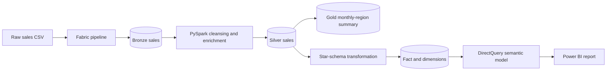

# Business Requirements Document: Sales Analytics

| Document item | Value |
|---|---|
| Project | Sales Analytics with Microsoft Fabric and Power BI |
| Document type | Business Requirements Document (BRD) |
| Version | 1.0 |
| Status | As-built baseline |
| Last updated | 17 October 2026 |
| Primary deliverable | Interactive Power BI sales analytics report |

## 1. Executive summary

The Sales Analytics project provides a single, decision-ready view of sales performance. It converts a raw transaction extract into governed analytical tables and an interactive Power BI report using Microsoft Fabric, PySpark, Delta Lake, a warehouse star schema, and a reusable semantic model.

The solution is intended for sales leaders, regional managers, product managers, and analysts who need to monitor revenue, sales activity, quantity sold, product mix, regional performance, and high-value customers. Users can review headline KPIs and move from company-wide results to a selected date, month, quarter, year, product category, region, or customer through report filtering and cross-filter interactions.

The current portfolio dataset contains 1,525 raw rows. Application of the approved cleansing rules produces 1,268 curated sales rows covering 2 January 2023 through 30 December 2024. These rows represent 1,250 distinct order IDs, ₹13,643,263.26 in revenue, $164,376.79 in converted revenue, and 10,043 units sold.

## 2. Business context and problem statement

Sales data supplied as a flat CSV is not sufficient for consistent management reporting. Raw records include cancelled orders, returned orders, and active rows with non-positive revenue. Business users also require common KPI definitions, time-based analysis, dimensional breakdowns, and a repeatable process that can be inspected from ingestion through reporting.

The project must therefore:

- create a trusted, analysis-ready sales dataset from the source extract;
- centralize business logic so that metrics are calculated consistently;
- present sales performance in a concise, interactive report;
- support analysis by time, product, region, and customer; and
- retain clear data lineage across raw, Bronze, Silver, Gold, warehouse, semantic, and presentation layers.

## 3. Business objectives

| ID | Objective | Intended business outcome |
|---|---|---|
| OBJ-01 | Establish a repeatable sales-data workflow | Reduce manual preparation and make transformations traceable. |
| OBJ-02 | Provide an executive performance overview | Allow users to understand revenue, activity, and quantity at a glance. |
| OBJ-03 | Enable time-based analysis | Reveal monthly movement and allow date, month, quarter, and year filtering. |
| OBJ-04 | Compare product categories | Identify categories that drive revenue, sales activity, and unit volume. |
| OBJ-05 | Compare regions | Identify leading and lagging regions by revenue and activity. |
| OBJ-06 | Identify valuable customers | Provide a ranked view of the top 10 customers by revenue. |
| OBJ-07 | Provide reusable business metrics | Ensure visuals use measures defined in a shared semantic model. |

## 4. Business questions

The solution must answer the following questions:

1. How much revenue has been generated in INR and in the illustrative USD conversion?
2. How many sales records and distinct orders are represented in the curated dataset?
3. How many units were sold, and what are the average revenue and quantity per order?
4. How do revenue and sales activity change by month?
5. Which product categories contribute the most revenue, activity, and quantity?
6. Which regions lead or lag by revenue and activity?
7. Which customers generate the most revenue?
8. How do the above results change for a selected date, month, quarter, or year?

## 5. Stakeholders and users

| Stakeholder or user | Primary need |
|---|---|
| Executive or sales leadership | Review headline KPIs and overall sales trends. |
| Regional sales manager | Compare regional performance and investigate changes over time. |
| Product or category manager | Understand category contribution to revenue and volume. |
| Sales analyst | Explore results across dimensions and validate business metrics. |
| Data engineer | Operate and troubleshoot the ingestion and transformation workflow. |
| BI developer or semantic-model owner | Maintain measures, relationships, formatting, and report behavior. |
| Data owner or governance reviewer | Confirm source rules, data quality, access, and lineage. |

## 6. Scope

### 6.1 In scope

- Ingestion of the sales CSV from `Files/raw/sales_data.csv` into Microsoft Fabric.
- Bronze, Silver, and Gold Delta tables in a Fabric Lakehouse.
- Cleansing of invalid order records and standardization of field names and dates.
- Calculation of an illustrative INR-to-USD revenue value.
- Monthly and regional sales aggregation.
- Creation of a reporting star schema with sales, customer, product, region, and date tables.
- A DirectQuery Power BI semantic model with reusable DAX measures.
- A single-page Power BI report with KPI cards, trends, dimensional comparisons, a top-customer table, slicers, and cross-filtering.
- Exported CSV files that allow reviewers to inspect the curated fact and dimension tables without Fabric access.

### 6.2 Out of scope

- Sales forecasting, budgets, targets, or variance-to-plan analysis.
- Profit, cost, discount, tax, or margin analysis because the source does not contain the required fields.
- Product-level analysis below `product_category`.
- Customer demographics, segmentation, or personally identifiable information other than customer name.
- Inventory, fulfillment, payment, or returns-process analytics.
- Real-time or streaming ingestion.
- Write-back or modification of source transactions from the report.
- Row-level security rules for separate business audiences.
- A historical foreign-exchange-rate service.
- Production deployment pipelines, alerting, or formal service-level agreements.

## 7. Assumptions and constraints

- `OrderID` identifies an order, but more than one curated row may share the same order ID.
- `CustomerName`, `Region`, and `ProductCategory` are supplied by the source and are treated as authoritative after filtering.
- The source date format is `dd-MM-yyyy`.
- Only records whose status is exactly `Active` and whose revenue is greater than zero are eligible for analysis.
- Revenue is supplied in INR.
- USD revenue is illustrative and uses the fixed rate ₹83 = $1; it is not suitable for statutory or period-accurate currency reporting.
- Notebook writes use overwrite mode, so the implemented process is a full batch rebuild rather than an incremental load.
- The semantic model queries the Fabric reporting model through DirectQuery.
- The repository does not define a refresh schedule; orchestration may be run on demand or scheduled separately in Fabric.
- Customer keys are derived from the distinct combination of customer name and region.

## 8. Solution overview

The pipeline separates storage and transformation responsibilities through a medallion pattern:

| Layer | Business purpose | Main output |
|---|---|---|
| Raw | Preserve the supplied extract | `sales_data.csv` |
| Bronze | Create a queryable landing table without applying business filters | `bronze_sales` |
| Silver | Produce clean, standardized transaction-level sales data | `silver_sales` |
| Gold | Provide a reusable monthly-region summary | `gold_sales_summary` |
| Reporting | Publish conformed fact and dimension tables | `fact_sales`, `dim_customer`, `dim_product`, `dim_region`, `dim_date` |
| Semantic | Centralize relationships and KPI definitions | `sales_report.SemanticModel` |
| Presentation | Enable interactive business analysis | `Sales Analytics Overview` |

## 9. Functional requirements

### 9.1 Ingestion and transformation

| ID | Requirement | Priority | Implemented by |
|---|---|---:|---|
| FR-01 | The solution shall ingest a header-based CSV sales extract and infer its schema. | Must | `CopyDataToDelta.ipynb` |
| FR-02 | The solution shall persist the source extract as a Bronze Delta table named `bronze_sales`. | Must | `CopyDataToDelta.ipynb` |
| FR-03 | The solution shall retain only rows where `Status = "Active"` and `Revenue > 0`. | Must | `TransformBronzeToSilver.ipynb` |
| FR-04 | The solution shall standardize source column names to snake_case. | Must | `TransformBronzeToSilver.ipynb` |
| FR-05 | The solution shall convert `OrderDate` from `dd-MM-yyyy` text to a proper date value. | Must | `TransformBronzeToSilver.ipynb` |
| FR-06 | The solution shall calculate `revenue_usd` as `revenue / 83`, rounded to two decimal places. | Must | `TransformBronzeToSilver.ipynb` |
| FR-07 | The solution shall persist cleansed transaction-level data as `silver_sales`. | Must | `TransformBronzeToSilver.ipynb` |
| FR-08 | The solution shall aggregate revenue, row count, and average row revenue by region and year-month. | Should | `BuildGoldLayer.ipynb` |
| FR-09 | The solution shall persist the aggregate as `gold_sales_summary`. | Should | `BuildGoldLayer.ipynb` |
| FR-10 | Each batch shall replace the target table contents to provide a reproducible snapshot. | Must for current release | All transformation notebooks |

### 9.2 Reporting data model

| ID | Requirement | Priority |
|---|---|---:|
| FR-11 | The reporting layer shall use a star schema with `fact_sales` at the curated sales-row grain. | Must |
| FR-12 | `fact_sales` shall contain order ID, date key, customer key, product key, region key, INR revenue, USD revenue, and quantity. | Must |
| FR-13 | The solution shall provide conformed customer, product, region, and date dimensions. | Must |
| FR-14 | The date key shall be an integer in `yyyyMMdd` format. | Must |
| FR-15 | The customer dimension shall contain one row per distinct customer-name and region combination. | Must |
| FR-16 | The product dimension shall contain one row per distinct product category. | Must |
| FR-17 | The region dimension shall contain one row per distinct region. | Must |
| FR-18 | The date dimension shall expose full date, year, month number, month name, quarter, day of week, and weekend indicator. | Must |
| FR-19 | Each fact foreign key shall have a many-to-one relationship to its corresponding dimension key. | Must |
| FR-20 | Month name shall sort chronologically by month number. | Must |

### 9.3 Semantic model and analytics

| ID | Requirement | Priority |
|---|---|---:|
| FR-21 | The semantic model shall connect to all reporting tables using DirectQuery. | Must |
| FR-22 | The model shall provide reusable measures for INR revenue, USD revenue, sales-row count, quantity, customer count, averages, and customer rank. | Must |
| FR-23 | Measures shall respond to the report filter context. | Must |
| FR-24 | Customer ranking shall rank customers by total revenue in descending dense order. | Must |
| FR-25 | Currency, whole-number, and decimal results shall be formatted consistently and labeled with their units. | Must |

### 9.4 Report and user interaction

| ID | Requirement | Priority |
|---|---|---:|
| FR-26 | The report shall provide a single overview page titled `Sales Analytics Overview`. | Must |
| FR-27 | The page shall display KPI cards for INR revenue, USD revenue, sales activity, quantity sold, average revenue per order, and average quantity per order. | Must |
| FR-28 | The page shall compare monthly revenue and sales activity in a combined trend visual. | Must |
| FR-29 | The page shall compare product categories by revenue, sales activity, and quantity sold. | Must |
| FR-30 | The page shall compare regions by revenue and sales activity. | Must |
| FR-31 | The page shall show the top 10 customers by revenue, including customer, revenue, activity, and rank. | Must |
| FR-32 | Users shall be able to filter the page by full date, month, quarter, and year. | Must |
| FR-33 | Selections in the main trend, product, region, and customer visuals shall cross-filter related visuals. | Must |
| FR-34 | Users shall be able to clear all slicer selections through the provided reset control. | Should |
| FR-35 | Exported report data shall be limited to summarized data. | Must |

## 10. Business rules

| ID | Rule |
|---|---|
| BR-01 | A row is reportable only when its status equals `Active`. |
| BR-02 | A reportable row must have revenue greater than zero. |
| BR-03 | Cancelled and returned rows are excluded from all curated metrics. |
| BR-04 | Active rows with zero or negative revenue are excluded from all curated metrics. |
| BR-05 | INR is the base reporting currency. |
| BR-06 | USD revenue equals INR revenue divided by 83 and rounded to two decimal places at row level. |
| BR-07 | A sales record is one row in `fact_sales`; it is not necessarily a distinct order. |
| BR-08 | A distinct order is identified by a distinct `order_id`. |
| BR-09 | Customer rank uses total INR revenue, descending, with dense ranking. |
| BR-10 | Date selections propagate from `dim_date` to `fact_sales` through `order_date_key`. |
| BR-11 | Customer selections propagate through `customer_key`, product selections through `product_key`, and region selections through `region_key`. |
| BR-12 | Month names must display in calendar order rather than alphabetical order. |

## 11. Data requirements

### 11.1 Source fields

| Source field | Type or format | Business use |
|---|---|---|
| `OrderID` | Text | Order identifier and distinct-order analysis |
| `OrderDate` | `dd-MM-yyyy` | Time analysis and date-key generation |
| `CustomerName` | Text | Customer analysis and ranking |
| `Region` | Text | Regional analysis and customer dimensionality |
| `ProductCategory` | Text | Product-category analysis |
| `Revenue` | Numeric, INR | Revenue metrics and eligibility rule |
| `Quantity` | Whole number | Unit-volume metrics |
| `Status` | Text | Inclusion or exclusion rule |

### 11.2 Reporting tables and grain

| Table | Grain | Required fields |
|---|---|---|
| `fact_sales` | One eligible source sales row | `order_id`, four foreign keys, `revenue`, `revenue_usd`, `quantity` |
| `dim_customer` | One customer-name and region combination | `customer_key`, `customer_name`, `region` |
| `dim_product` | One product category | `product_key`, `product_category` |
| `dim_region` | One region | `region_key`, `region` |
| `dim_date` | One calendar date | Date key and calendar attributes |
| `gold_sales_summary` | One region and year-month combination | `region`, `year_month`, total revenue, row count, average row revenue |

### 11.3 Data-quality controls

The process shall support validation of the following conditions:

- source headers and data types are readable;
- row counts are captured before and after cleansing;
- all curated rows satisfy the active and positive-revenue rules;
- order dates parse successfully;
- fact foreign keys resolve to dimension records;
- monetary and quantity fields are numeric;
- required identifiers and dimensional attributes are not blank; and
- aggregate totals reconcile from Silver to the reporting fact table and semantic model.

## 12. KPI definitions

| KPI | Business definition | Current semantic-model calculation |
|---|---|---|
| Total Revenue | Sum of eligible revenue in INR | `SUM(fact_sales[revenue])` |
| Total Revenue (USD) | Sum of row-level revenue converted at ₹83 per $1 | `SUM(fact_sales[revenue_usd])` |
| Sales Records | Count of curated fact rows | `COUNTROWS(fact_sales)`; currently named `Total Orders` |
| Distinct Orders | Count of unique order IDs | `DISTINCTCOUNT(fact_sales[order_id])`; used as the denominator in two average measures but not exposed as a standalone measure |
| Total Quantity Sold | Sum of units on eligible rows | `SUM(fact_sales[quantity])` |
| Total Customers | Distinct customer names in the current filter context | `DISTINCTCOUNT(dim_customer[customer_name])` |
| Average Order Value | Total revenue divided by curated fact-row count | `DIVIDE([Total Revenue], [Total Orders], 0)` |
| Average Revenue per Distinct Order | Total revenue divided by distinct order ID count | `DIVIDE(SUM(revenue), DISTINCTCOUNT(order_id))`; currently named `Avg Revenue per Order` |
| Average Quantity per Distinct Order | Total quantity divided by distinct order ID count | `DIVIDE(SUM(quantity), DISTINCTCOUNT(order_id))` |
| Customer Rank | Revenue rank across all customer names | `RANKX(ALL(dim_customer[customer_name]), [Total Revenue], , DESC, Dense)` |

> **Metric naming note:** The implemented `Total Orders` measure counts rows, not unique `order_id` values. The current baseline contains 1,268 sales rows and 1,250 distinct orders. Business users must not treat these values as equivalent. A production release should either rename the measure to `Sales Records` or change it to a distinct count and then align all dependent averages and visual labels.

## 13. Report requirements

The overview page shall include the following analytical elements:

| Area | Visual or control | Required analysis |
|---|---|---|
| Executive KPIs | Six cards | INR revenue, USD revenue, sales records, quantity, revenue per order, quantity per order |
| Time trend | Line and stacked-column combination chart | Monthly revenue and sales activity |
| Product | Column chart | Revenue by product category |
| Product | Donut chart | Sales activity by product category |
| Product | Donut chart | Quantity sold by product category |
| Region | Bar chart | Revenue by region |
| Region | Bar chart | Sales activity by region |
| Customer | Top-10 table | Customer, revenue, sales activity, and revenue rank |
| Filters | Date slicer | Restrict analysis to a full-date range or selection |
| Filters | Month slicer | Restrict analysis by month name |
| Filters | Quarter slicer | Restrict analysis by quarter |
| Filters | Year slicer | Restrict analysis by year |
| Navigation | Reset action | Clear all slicer selections and restore the default slicer state |

All business visuals shall use the shared semantic-model measures. Slicers and visual selections shall update applicable KPIs and comparisons without requiring users to leave the overview page.

## 14. Non-functional requirements

| ID | Requirement |
|---|---|
| NFR-01 | **Usability:** The report shall fit on one page and present KPIs, trends, and comparisons in a clear visual hierarchy. |
| NFR-02 | **Consistency:** Measure names, chart titles, units, and formats shall use consistent business terminology. |
| NFR-03 | **Performance:** Interactions shall complete within a reasonable time for the expected dataset and available Fabric capacity; model and visual design shall avoid unnecessary high-cardinality queries. |
| NFR-04 | **Reliability:** Re-running the batch with the same source shall produce the same curated snapshot and totals. |
| NFR-05 | **Maintainability:** Transformation stages, business measures, and report definitions shall remain source-controlled and independently inspectable. |
| NFR-06 | **Traceability:** A reported value shall be traceable through semantic measure, reporting table, Silver data, and source record. |
| NFR-07 | **Data quality:** Invalid dates, unresolved keys, unexpected statuses, and reconciliation differences shall be detectable before business consumption. |
| NFR-08 | **Accessibility:** Report content shall use readable labels, sufficient contrast, and formats that do not rely only on color to convey meaning. |
| NFR-09 | **Compatibility:** The supplied PBIX/PBIP artifacts shall open in a compatible Power BI Desktop version and connect to the intended Fabric semantic model when authorized. |
| NFR-10 | **Recoverability:** Bronze data shall remain available so curated outputs can be rebuilt after a failed or incorrect transformation. |

## 15. Security and governance requirements

- Access to Fabric items and the Power BI report shall be limited through workspace and report permissions.
- Customer names shall be treated as business-confidential data and exposed only to authorized users.
- Credentials, connection secrets, and tenant-specific tokens shall not be committed to the repository.
- The report shall permit summarized-data export only, as configured in the report definition.
- Changes to business rules or KPI definitions shall be reviewed before publication because they can alter historical comparisons.
- Production use should assign accountable owners for the source data, pipeline, semantic model, and report.
- If audiences require different regional or customer visibility, row-level security must be designed and tested before release; it is not part of the current implementation.

## 16. Acceptance criteria

| ID | Acceptance criterion |
|---|---|
| AC-01 | A run against the repository source loads 1,525 rows into the raw/Bronze stage. |
| AC-02 | Cleansing excludes 161 cancelled rows, 91 returned rows, and 5 active non-positive-revenue rows. |
| AC-03 | The curated Silver and `fact_sales` outputs each contain 1,268 eligible rows. |
| AC-04 | Every curated row has `status = Active` upstream and revenue greater than zero. |
| AC-05 | The curated sales period is 2 January 2023 through 30 December 2024. |
| AC-06 | `fact_sales` contains 1,250 distinct order IDs and total quantity of 10,043. |
| AC-07 | Total INR revenue reconciles to ₹13,643,263.26. |
| AC-08 | Total row-level converted revenue reconciles to $164,376.79, subject to two-decimal row rounding. |
| AC-09 | The reporting model contains 93 customer-dimension rows, 3 product categories, 4 regions, and 731 calendar dates. |
| AC-10 | All fact foreign keys match an existing member of the appropriate dimension. |
| AC-11 | The date dimension spans 1 January 2023 through 31 December 2024 and month names sort by month number. |
| AC-12 | The semantic model exposes all KPI measures listed in Section 12 and each responds to valid filter context. |
| AC-13 | The report contains the KPI, time, product, region, customer, and filter elements listed in Section 13. |
| AC-14 | Selecting a principal product, region, trend, or customer data point filters the configured related visuals. |
| AC-15 | Date, month, quarter, and year slicers restrict the applicable metrics and visuals consistently. |
| AC-16 | The top-customer table returns no more than 10 customers ordered by total revenue. |
| AC-17 | The reset action clears all slicer selections and restores the intended default slicer state. |
| AC-18 | Metric labels clearly distinguish sales-row count from distinct-order count before production business use. |

## 17. Current data baseline

The following values provide a regression baseline for the versioned portfolio dataset:

| Metric | Expected value |
|---|---:|
| Raw rows | 1,525 |
| Curated sales rows | 1,268 |
| Distinct order IDs | 1,250 |
| Excluded cancelled rows | 161 |
| Excluded returned rows | 91 |
| Excluded active rows with zero or negative revenue | 5 |
| Curated date range | 2 Jan 2023–30 Dec 2024 |
| Total revenue | ₹13,643,263.26 |
| Converted revenue | $164,376.79 |
| Quantity sold | 10,043 |
| Customer dimension rows | 93 |
| Distinct customer names | 40 |
| Product categories | 3 |
| Regions | 4 |
| Date dimension rows | 731 |

These values are test fixtures for the supplied dataset, not permanent business targets.

## 18. Risks, issues, and dependencies

| Risk, issue, or dependency | Impact | Recommended treatment |
|---|---|---|
| `Total Orders` counts fact rows rather than distinct order IDs | Users may overstate order volume or misread averages. | Rename it to `Sales Records` or redefine it as a distinct count and retest dependent measures. |
| Two average-revenue measures use different denominators | Similar labels can present different values. | Adopt one approved business definition and remove or clearly relabel the other. |
| Fixed FX rate | USD results are illustrative rather than historically accurate. | Add a dated FX dimension and define conversion timing and rate source. |
| Overwrite-only loading | Full rebuilds do not preserve load history and may not scale. | Add incremental ingestion, watermarks, and audit columns for production. |
| Inferred source schema | Unexpected source changes may silently affect types or fail a run. | Define and validate an explicit schema and reject incompatible inputs. |
| Surrogate keys generated with `monotonically_increasing_id()` | Keys may change between rebuilds and are not durable across snapshots. | Use deterministic or warehouse-managed surrogate keys for production. |
| Customer identity is based on name and region | Renames, duplicates, or moves may create ambiguous customer records. | Introduce a stable customer source identifier. |
| No formal orchestration or refresh SLA in the repository | Users may not know data freshness or failure status. | Define schedule, ownership, monitoring, notifications, and freshness display. |
| No row-level security | All authorized report users may see all loaded customers and regions. | Define audience-specific access rules if required. |
| DirectQuery depends on Fabric availability and capacity | Report responsiveness depends on the upstream service. | Monitor query performance and capacity; consider aggregations or import mode if necessary. |

## 19. Future enhancements

Potential later releases may include:

- incremental and parameterized ingestion;
- explicit schemas, automated data-quality tests, and quarantine handling;
- dated exchange rates and selectable reporting currency;
- durable business keys and slowly changing dimensions;
- standalone distinct-order measures and reconciled KPI naming;
- targets, budget variance, margin, and profitability analysis when new source fields become available;
- period-over-period comparisons and forecasting;
- pipeline monitoring, alerting, deployment pipelines, and refresh SLAs;
- row-level security by region or management hierarchy; and
- additional drill-through pages for customer, product, and regional detail.

## 20. Requirement traceability

| Business objective | Supporting requirements | Primary artifact |
|---|---|---|
| OBJ-01 Repeatable workflow | FR-01–FR-20, NFR-04–NFR-07 | Fabric notebooks and Delta tables |
| OBJ-02 Executive overview | FR-21–FR-27 | Semantic model and KPI cards |
| OBJ-03 Time analysis | FR-18, FR-20, FR-28, FR-32 | Date dimension, trend visual, slicers |
| OBJ-04 Product comparison | FR-16, FR-29 | Product dimension and category visuals |
| OBJ-05 Region comparison | FR-17, FR-30 | Region dimension and regional visuals |
| OBJ-06 Valuable customers | FR-15, FR-24, FR-31 | Customer dimension, rank measure, top-10 table |
| OBJ-07 Reusable metrics | FR-21–FR-25 | Power BI semantic model |

## 21. Glossary

| Term | Definition |
|---|---|
| Bronze | Raw, queryable Delta representation of the ingested source. |
| Silver | Cleansed and standardized transaction-level dataset. |
| Gold | Business-oriented aggregate derived from Silver data. |
| Fact table | Table containing measurable sales events and dimension keys. |
| Dimension | Descriptive table used to group or filter facts. |
| Semantic model | Power BI model containing tables, relationships, measures, and formatting. |
| DirectQuery | Query mode in which report queries are sent to the upstream model rather than relying on a full imported copy. |
| Sales record | One eligible row in `fact_sales`. |
| Distinct order | One unique `order_id`, regardless of how many fact rows share it. |

## 22. Source-of-truth artifacts

- Project overview and as-built results: [`../README.md`](../README.md)
- Ingestion and transformation logic: [`../fabric/notebooks/`](../fabric/notebooks/)
- Semantic-model tables, relationships, and measures: [`../fabric/semantic-model/sales_report.SemanticModel/`](../fabric/semantic-model/sales_report.SemanticModel/)
- Power BI report definition: [`../fabric/semantic-model/sales_report.Report/`](../fabric/semantic-model/sales_report.Report/)
- Curated validation extracts: [`../data/`](../data/)
- Packaged Power BI report: [`../powerbi/sales_report.pbix`](../powerbi/sales_report.pbix)
